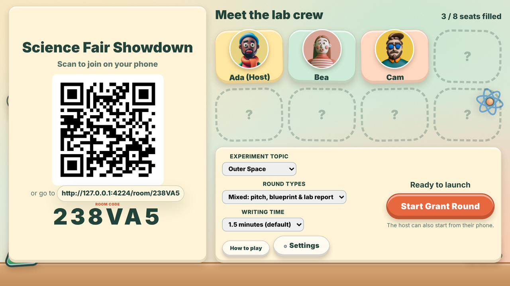
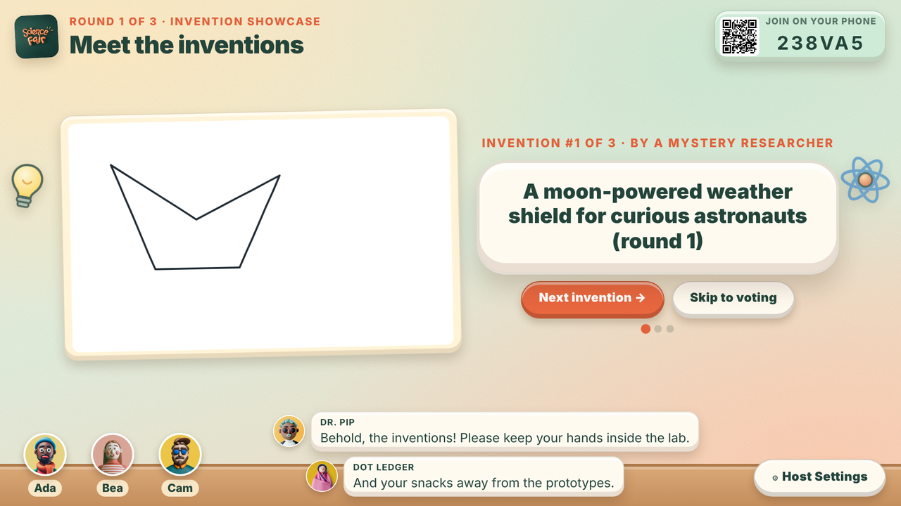
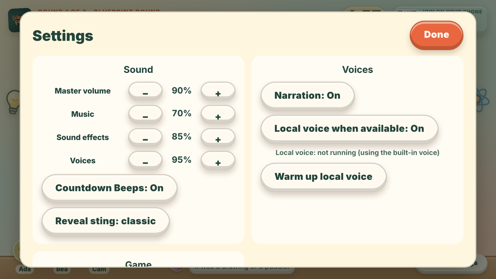
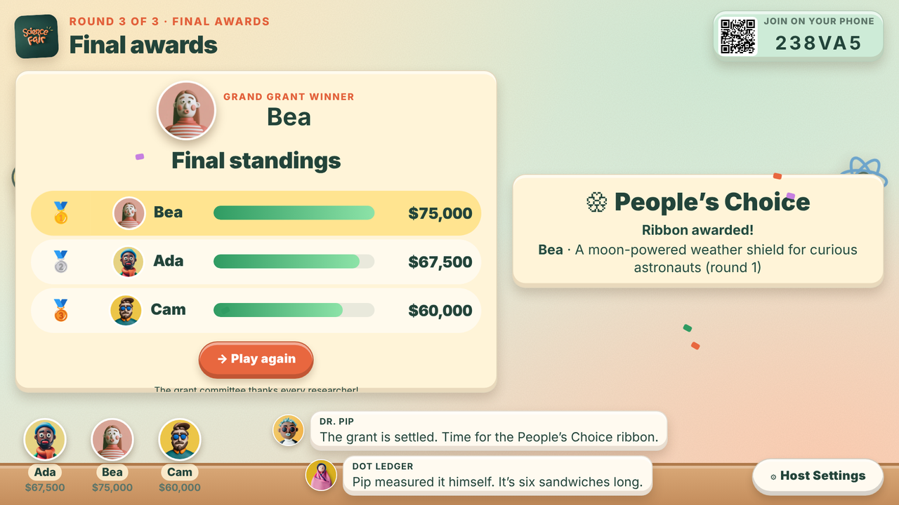
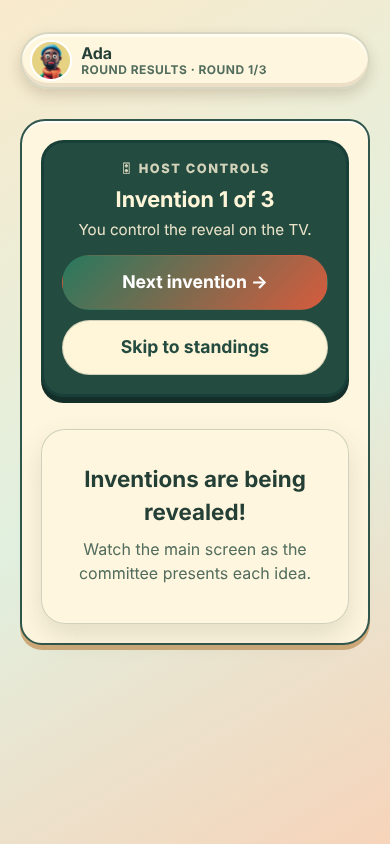

# Science Fair Showdown — Android TV app

A small launcher app that shows the game's shared "host" screen full screen on
an Android TV (or Google TV / Fire TV-style stick, or a tablet). Phones still
join by scanning the QR code on the TV.



| Showcase on the TV | Settings with the remote |
| --- | --- |
|  |  |

| Final awards | The host runs the show from a phone |
| --- | --- |
|  |  |

These are rendered at the TV app's own size (a 960×540 web view at 2× density, which is what a 1080p Android TV shows), from an automated playthrough of the current build.

What it adds over opening the page in a TV browser:

- A tile on the TV home screen.
- Remembers your game server address.
- Opens `/tv`, which creates a Science Fair room and shows the lobby straight away.
- Plays music and sound without needing a click, and keeps the TV awake.
- Committee lines play from the game's recordings and inventions use the local voice when it's running. The TV's own text-to-speech is used only when *Built-in voice fallback* is on in Settings (Android WebView has no browser speech, so the app provides it).
- Back closes an open dialog on the page (like Settings); otherwise it opens a small menu: back to game, new room, or change server.

The host player runs the show from their phone (start, end sketching, skip
through the showcase, next invention, standings, next round, ribbon, play
again), so you shouldn't need the remote once the lobby is up. When you do,
arrow keys and OK reach every button, including Settings.

## 1. Run the game on your computer

From `socketIIPartyGame_fe` (installs once with `npm ci` in both folders):

```bash
npm run play
```

This builds the frontend and starts the game server on port 3000. It prints
lines like `On your network: http://192.168.1.20:3000` — that's the address
for the TV. Allow Node.js through the Windows firewall on private networks
when asked.

## 2. Build the APK

1. Install [Android Studio](https://developer.android.com/studio).
2. Double-click `open-in-android-studio.bat` (or **File → Open** this folder) and let Gradle sync. The project uses Gradle 9.3.1 and Android Gradle Plugin 9.1.1, which run on the JDK 25 bundled with current Android Studio.
3. **Build → Generate App Bundles or APKs → Generate APKs**. The APK lands in `app/build/outputs/apk/debug/app-debug.apk`.

## 3. Install it on the TV

1. On the TV, turn on developer mode (**Settings → System → About**, click **Android TV OS build** 7 times), then turn on **USB debugging** / **Network debugging** in **Developer options**.
2. Double-click `install-on-tv.bat` (pass a different IP as the first argument if your TV isn't `192.168.1.103`). It finds `adb` from the SDK Android Studio uses, connects, waits while you accept **Allow debugging?** on the TV (tick **Always allow**), installs the APK and starts the app. Its output is also saved to `install-log.txt`.

`tv-screenshot.bat` saves what the TV is showing to `tv-screen.png` (handy for checking text size).

Manual alternative: `adb connect <tv-ip>:5555` then `adb install -r app/build/outputs/apk/debug/app-debug.apk`. You can also pick the TV in Android Studio's device menu after connecting and press Run.

## 4. Play

Open **Science Fair Showdown** from the TV's apps row, type the address from
step 1 (just `192.168.1.20` works — port 3000 is assumed) and press Connect.

## Notes

- Everything stays on your home network; the app only talks to the address you type.
- No libraries are used (plain Activity + WebView), so the APK is tiny and builds offline after the first sync.
- If the TV voice sounds wrong, change the TV's text-to-speech engine/voice in Android settings, or turn Narration off in Host Settings.
- The optional local VoxCPM voice still works: it runs on the computer, and the TV just plays the audio it sends.
